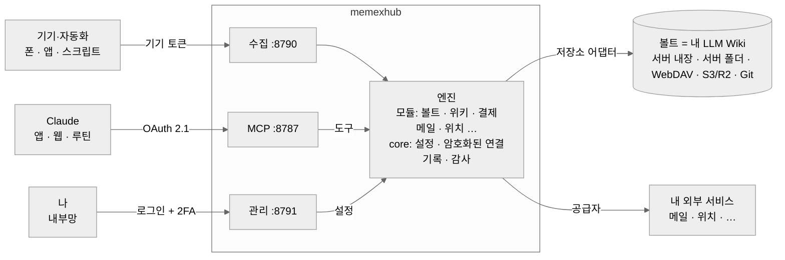

# memexhub

**셀프호스팅 메멕스 — 내 노트와 생활 기록으로 계속 자라는, Claude용 LLM Wiki 엔진.**

[English](README.md) · [문서](docs/ko/) · [보안](SECURITY.md)

> ⚠️ 초기 개발 단계(v0.1)예요. 인터페이스가 바뀔 수 있어요. Anthropic, Obsidian과 관계없는 개인 프로젝트예요.

1945년 Vannevar Bush는 *Memex*를 상상했어요. 내가 읽고 기록한 모든 것을 담아 서로 이어 주는 개인용 기계요. memexhub는 그걸 지금의 도구로 만드는 작은 서버예요.

- **볼트**(마크다운 노트 폴더)가 기억이에요. Obsidian 볼트, 서버 폴더, WebDAV, S3/R2, Git 어느 것이든 돼요 (Notion은 예정).
- **Claude**(앱, 웹, 예약 루틴)가 **커넥터 하나**로 그걸 읽고 써요.
- 엔진은 볼트를 **[LLM Wiki](#llm-wiki가-뭐예요)**로 관리해요. 원본은 그대로 두고, LLM이 위키 페이지를 다듬고, 목차와 링크는 엔진이 정리해요.
- **새 원본은 저절로 들어와요.** 저장한 글, 그리고 기기와 서비스에서 오는 생활 기록(카드 결제, 교통, 건강, 위치, 메일)이요.



## LLM Wiki가 뭐예요?

물어볼 때마다 원본 문서를 뒤지는 대신, LLM이 나와 함께 쓰고 다듬는 개인 지식 위키예요 (Andrej Karpathy가 소개한 방식). 세 부분으로 나뉘어요.

- **원본** — 내가 모은 것: 글, 메모, 기록. 한 번 저장하면 고치지 않아요.
- **위키** — LLM이 원본을 읽고 쓰는 페이지: 주제, 사람, 프로젝트, 요약. 서로 링크로 이어지고 계속 갱신돼요.
- **규칙** — 이 위키가 어떻게 짜여 있고 어떻게 써야 하는지 LLM에게 알려 주는 노트 하나.

지식을 위키에 한 번 정리해 두고 계속 다듬으니까, 답은 이미 연결된 페이지에서 나와요. memexhub는 그 엔진이에요. Claude에게 도구를 주고, 원본을 지키고, 목차·로그·링크를 정리하고, 위키를 점검해요. 볼트는 그 위키가 저장되는 곳일 뿐이에요.

## 왜

- **커넥터 하나, 데이터는 내 것.** Claude는 잘 정의된 도구 묶음 하나만 받아요. 데이터는 내 서버나 내 클라우드 계정에 있어요.
- **구조는 자유.** 엔진은 폴더 이름이 아니라 **역할**(원본, 위키, 목차, 일지, 규칙)만 알아요. PARA, Zettelkasten, Karpathy식 raw/wiki, 평평한 폴더 다 돼요.
- **정답이 있는 건 엔진이.** 합계, 표, 링크 점검, 목차는 엔진이 계산해요(정확하고 공짜). 판단과 글쓰기는 Claude가 해요.
- **기본값이 안전.** 아래 보안 참고.

## 진행 상황

| 영역 | 상태 |
|---|---|
| core (설정, 암호화된 연결, 기록, 감사), 실행 환경 층 | ✅ |
| 볼트 저장소: 서버 내장·서버 폴더, WebDAV, S3·R2·MinIO | ✅ · Git 📝 |
| 볼트 도구 (목록·읽기·검색·통계·쓰기·덧붙이기·휴지통·이동) + 보호 경로 | ✅ |
| Claude 커넥터용 OAuth 2.1, 기기 토큰, IP 허용 목록 | ✅ |
| 관리 화면: 설치 마법사, 볼트, 커넥터, 기기 토큰, 2단계 인증 | ✅ 최소 |
| 위키 모듈 (구조, 점검, 원본 저장, 목차, 로그, 역링크), 역할과 프리셋, 한 번만 쓰는 원본 | ✅ |
| 결제: 카드 문자(현대·삼성), Apple Pay·교통, 결제·돈 노트, 결제 메일, `payments_day`, 메시지 레시피 + 대기함 | ✅ |
| 메일 (읽기 전용 IMAP: 카카오, 네이버, Gmail, Outlook, 직접 입력) | ✅ |
| 위치(Dawarich, OwnTracks, OSM 지명), `location_day`, 결제 장소 이름 | ✅ |
| 건강(iOS 단축어, Health Auto Export), 건강 노트, `health_day` | ✅ |
| 할 일(Google Tasks, 계정 여러 개, 로그인 버튼) | ✅ |
| `day_summary`, `week_summary` (루틴용 하루·한 주 한 번에) | ✅ |
| 서버 볼트를 Obsidian과 동기화하는 내장 WebDAV | ✅ |
| Notion 출력, Cloudflare 버튼 설치 | 📝 |

## 빠르게 시작 (개발)

```bash
npm install
cp .env.example .env    # MEMEXHUB_SECRET(openssl rand -base64 48)과 PUBLIC_URL 설정
npm run dev
```

서버가 **일회용 설치 코드**를 출력해요. 관리 화면(`http://localhost:8791`)을 열어 코드를 넣고, 관리자 계정을 만들고, 볼트를 연결한 뒤, Claude에 `PUBLIC_URL/mcp`를 사용자 지정 커넥터로 추가하면 돼요.

**Docker:** [설치 안내](docs/ko/install.md) (서명된 이미지, 보안 설정된 compose 파일). 버튼 한 번 설치는 예정이에요 — [로드맵](docs/ko/roadmap.md).

## 보안

memexhub는 인터넷에 열려 있고, 코드가 공개돼 있고, LLM이 읽는 내용에 속을 수 있다고 전제해요.

- 밖으로 데이터를 보내는 도구가 없어요 (메일 발송, 임의 URL 요청 없음)
- 규칙 노트(`CLAUDE.md` 등)는 보호돼서, 도구로 루틴의 지시를 바꿔 쓸 수 없어요
- OAuth 2.1 + PKCE, 허용된 redirect 호스트만, 회전하는 리프레시 토큰과 재사용 감지, 해시로만 저장하는 불투명 토큰
- `/mcp`를 Anthropic 서버에서만 받게 하는 선택 옵션
- 비밀값은 암호화해서 저장(AES-256-GCM), 관리 화면은 기본 비공개, 새 서버는 설치 코드로 잠금

전체 위협 모델: [docs/ko/security.md](docs/ko/security.md). 취약점은 비공개로 신고해 주세요: [SECURITY.md](SECURITY.md).

## 라이선스

MIT
