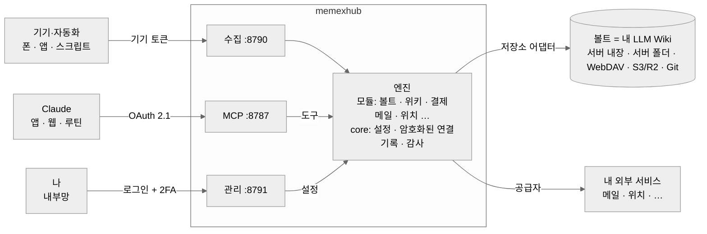

# memexhub

**내 AI를 위한 두 번째 뇌.** 내 노트와 생활 기록을 LLM Wiki로 모으고, 믿을 수 있게 정리해서, 어떤 AI에게든 커넥터 하나로 꺼내 주는 셀프호스팅 엔진이에요.

[English](README.md) · [문서](docs/ko/README.md) · [보안](SECURITY.md)

> ⚠️ 초기 개발 단계(v0.1)예요. 인터페이스가 바뀔 수 있어요. Anthropic, Obsidian과 관계없는 개인 프로젝트예요.

## 세 개의 뇌

AI와 일할 때는 뇌가 셋 있어요.

| | 뇌 | 하는 일 | 누가 |
|---|---|---|---|
| 1뇌 | **나** | 보고, 느끼고, 판단하고, 결정 | 나 |
| 2뇌 | **내 지식**: 노트, 원본, 생활 기록 (LLM Wiki) | 기억하고, 잇고, 틀리지 않게 | **memexhub** |
| 3뇌 | **AI**: Claude 앱, Claude Code, MCP를 쓰는 에이전트 | 생각하고, 쓰고, 실행 | 내가 고름 |

3뇌 도구는 달마다 바뀌어요. 오래 남는 건 2뇌이고, AI가 *나를 알게* 만드는 것도 2뇌예요. memexhub는 그 2뇌를 만들고 정리해 둬요. 그래서 AI를 바꿔도 잃는 게 없어요.

이름은 1945년 Vannevar Bush가 상상한 *Memex*(기억 확장기)에서 왔어요. 내가 읽고 기록한 모든 것을 담아 서로 이어 주는 개인용 기계예요.

## memexhub가 하는 일: 모으기 · 정리하기 · 꺼내 주기

1. **모으기**: 따로 정리하지 않아도 기록이 들어와요.
   - 폰의 카드 결제, 교통, Apple Pay
   - 건강, 위치 (OwnTracks 앱은 QR 한 번이면 설정 끝)
   - 메일, 캘린더, 음악, 날씨
   - 모아 둔 글은 **원본**으로 저장
2. **정리하기**: 볼트는 믿을 수 있게 유지되는 **[LLM Wiki](#llm-wiki가-뭐예요)**예요.
   - 원본은 고치지 않아요.
   - 위키 페이지는 실제 원본을 인용해야만 저장돼요.
   - AI가 쓴 페이지는 내가 확인하기 전까지 **draft**예요.
   - 원본끼리 어긋나면 규칙 노트의 신뢰 순서를 따라요.
   - 링크, 목차, 점검은 코드가 정확하게 계산해요.
3. **꺼내 주기**: **MCP 커넥터 하나**로 어떤 AI든 내 볼트와 기록을 써요.
   - Claude 앱, 웹, 예약 루틴, Claude Code, 다른 MCP 에이전트
   - 하루·한 주 요약, 결제, 다녀온 곳, 메일
   - 노트를 읽고 하루를 지도로 보는 관리 화면

**이건 아니에요:** memexhub는 에이전트가 아니고 모델도 돌리지 않아요. 생각은 연결한 AI가 하고, memexhub는 그 AI가 꺼내 쓰는 기억이에요. 기억은 내 서버나 내 클라우드 계정에 있어요.



## LLM Wiki가 뭐예요?

물어볼 때마다 원본 문서를 뒤지는 대신, LLM이 나와 함께 쓰고 다듬는 개인 지식 위키예요. Andrej Karpathy가 소개한 방식이에요. 세 부분으로 나뉘어요.

- **원본**: 내가 모은 것: 글, 메모, 기록. 한 번 저장하면 고치지 않아요.
- **위키**: LLM이 원본을 읽고 쓰는 페이지: 주제, 사람, 프로젝트, 요약. 서로 링크로 이어지고 계속 갱신돼요.
- **규칙**: 이 위키가 어떻게 짜여 있고 어떻게 써야 하는지 LLM에게 알려 주는 노트 하나.

지식을 위키에 한 번 정리해 두고 계속 다듬으니까, 답은 이미 연결된 페이지에서 나와요. memexhub는 그 엔진이에요.
- AI에게 도구를 줘요.
- 원본을 지켜요.
- 목차, 로그, 링크를 정리하고 위키를 점검해요.

볼트는 그 위키가 저장되는 곳일 뿐이에요.

**하네스.** 내 기억을 쓰는 AI는 실수도 같이 써 넣을 수 있고, 그 실수는 쌓여요. 그래서 일을 나눠요.
- **판단은 AI:** 원본이 무슨 뜻인지, 무엇을 고칠지
- **정답이 하나인 것은 코드:** 프론트매터, 페이지마다 실제 원본, 링크, 크기, 목차
- **확인은 나:** 내가 *확인했어요*를 누르기 전까지 페이지는 `draft`예요(누르면 `stable`). 낡은 페이지는 지우지 않고 `deprecated`로 남겨요.

자세히: [위키 엔진](docs/ko/wiki-engine.md#하네스-검사는-코드가-확인은-주인이-).

## 왜

- **커넥터 하나, 데이터는 내 것.** AI는 잘 정의된 도구 묶음 하나만 받아요. 데이터는 내 서버나 내 클라우드 계정에 있어요.
- **AI가 바뀌어도 기억은 그대로.** 오늘은 Claude, 내일은 다른 AI여도 돼요. 볼트는 그냥 마크다운이고 커넥터는 MCP예요.
- **구조는 자유.** 엔진은 폴더 이름이 아니라 **역할**(원본, 위키, 목차, 일지, 규칙)만 알아요. PARA, Zettelkasten, Karpathy식 raw/wiki, 평평한 폴더 다 돼요.
- **정답이 있는 건 엔진이.** 합계, 표, 링크 점검, 목차는 엔진이 계산해요(정확하고 공짜). 판단과 글쓰기는 Claude가 해요.
- **기본값이 안전.** 아래 보안 참고.

## 진행 상황

| 영역 | 상태 |
|---|---|
| core (설정, 암호화된 연결, 기록, 감사), 실행 환경 층 | ✅ |
| 볼트 저장소: 서버 내장·서버 폴더, WebDAV, S3·R2·MinIO | ✅ · Git 📝 |
| 볼트 도구 (목록·읽기·검색·통계·쓰기·덧붙이기·휴지통·이동) + 보호 경로 | ✅ |
| Claude 커넥터용 OAuth 2.1, 기기 토큰, IP 허용 목록 | ✅ |
| 관리 화면: 3단계 처음 설정, 연결, 기기(폰 설정 QR), 2단계 인증 QR, 사진·PDF까지 보는 노트 뷰어, 하루 지도 | ✅ |
| 위키 모듈 (구조, 점검, 원본 저장, 목차, 로그, 역링크), 역할과 프리셋, 한 번만 쓰는 원본 | ✅ |
| 위키 하네스: 쓰기 검사, 관리 화면에서 확인하는 `draft → stable → deprecated`, `wiki_check`, `wiki_pending` | ✅ |
| 결제: 카드 문자(현대·삼성), Apple Pay·교통, 결제·돈 노트, 결제 메일, `payments_day`, 메시지 레시피 + 대기함 | ✅ |
| 메일 (읽기 전용 IMAP: 카카오, 네이버, Gmail, Outlook, 직접 입력) | ✅ |
| 위치(Dawarich, OwnTracks, OSM 지명), `location_day`, 결제 장소 이름, 지도 화면 | ✅ |
| 캘린더(CalDAV, iCloud, Google), 날씨, 홈 어시스턴트, 음악(Last.fm, Spotify) | ✅ |
| 건강(iOS 단축어, Health Auto Export), 건강 노트, `health_day` | ✅ |
| 할 일(Google Tasks, 계정 여러 개, 로그인 버튼) | ✅ |
| `day_summary`, `week_summary` (루틴용 하루·한 주 한 번에) | ✅ |
| 서버 볼트를 Obsidian과 동기화하는 내장 WebDAV | ✅ |
| Notion 내보내기 (결제, 건강) | ✅ |
| Cloudflare 버튼 설치 (Workers + D1 + R2) | ✅ |
| 홈 어시스턴트 애드온, 시놀로지, Railway | ✅ (첫 릴리스 후) |
| Notion을 볼트 저장소로 (베타, 작은 볼트) | ✅ |

## 빠르게 시작 (개발)

```bash
npm install
cp .env.example .env    # MEMEXHUB_SECRET(openssl rand -base64 48)과 PUBLIC_URL 설정
npm run dev
```

서버가 **일회용 설치 코드**를 출력해요. 관리 화면(`http://localhost:8791`)을 열어 코드를 넣고 관리자 계정을 만들어요. 그다음은 짧은 3단계예요: 언어·시간, 볼트, Claude 앱. 마지막 단계는 Claude가 연결될 때까지 기다렸다가 알려줘요.

**서버가 없다면?** [](https://deploy.workers.cloudflare.com/?url=https://github.com/Hchanghyeon/memexhub): [Cloudflare 안내](docs/ko/cloudflare.md)

**Docker:** [설치 안내](docs/ko/install.md) (서명된 이미지, 보안 설정된 compose 파일). 홈 어시스턴트·시놀로지·Railway: [앱스토어](docs/ko/app-stores.md).

## 보안

memexhub는 인터넷에 열려 있고, 코드가 공개돼 있고, LLM이 읽는 내용에 속을 수 있다고 전제해요.

- 밖으로 데이터를 보내는 도구가 없어요 (메일 발송, 임의 URL 요청 없음)
- 규칙 노트(`CLAUDE.md` 등)는 보호돼서, 도구로 루틴의 지시를 바꿔 쓸 수 없어요
- OAuth 2.1 + PKCE, 허용된 redirect 호스트만, 회전하는 리프레시 토큰과 재사용 감지, 해시로만 저장하는 불투명 토큰
- `/mcp`를 Anthropic 서버에서만 받게 하는 선택 옵션
- 비밀값은 암호화해서 저장(AES-256-GCM), 관리 화면은 기본 비공개, 새 서버는 설치 코드로 잠금

전체 위협 모델: [docs/ko/security.md](docs/ko/security.md). 취약점은 비공개로 신고해 주세요: [SECURITY.md](SECURITY.md).

## 라이선스

MIT
