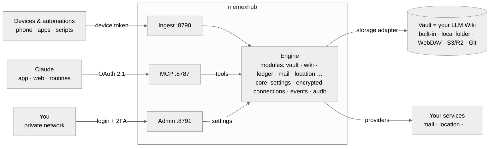

# memexhub

**The second brain for your AI.** A self-hosted engine that collects your notes and life logs into an LLM Wiki, keeps it trustworthy, and serves it to any AI through one connector.

[한국어](README.ko.md) · [Docs](docs/) · [Security](SECURITY.md)

> ⚠️ Early development (v0.1). Interfaces change. Not affiliated with Anthropic or Obsidian.

## Three brains

Working with AI involves three brains:

| | Brain | Does | Who |
|---|---|---|---|
| 1st | **You** | notice, feel, judge, decide | you |
| 2nd | **Your knowledge** — notes, sources, life logs, as an LLM Wiki | remember, connect, stay true | **memexhub** |
| 3rd | **AI** — Claude app, Claude Code, any MCP agent | reason, write, act | your choice |

Third-brain tools change every month. The second brain is what lasts, and what makes an AI *know you*. memexhub builds that second brain and keeps it in order, so you can swap the AI without losing anything.

The name comes from the *Memex*, the personal "memory extender" that Vannevar Bush imagined in 1945: a machine that stores everything you read and record, and links it together.

## What memexhub does: collect · curate · serve

1. **Collect** — your records arrive without you filing them:
   - card payments, transit and Apple Pay from your phone
   - health and location (set up the OwnTracks app with one QR scan)
   - mail, calendar, music, weather
   - articles you keep, saved as **sources**
2. **Curate** — the vault is an **[LLM Wiki](#what-is-an-llm-wiki)** that stays trustworthy:
   - Sources are never edited.
   - Wiki pages must cite an existing source, or they are not saved.
   - What the AI writes is a **draft** until you confirm it.
   - Conflicts follow the trust order in your rules note.
   - Links, indexes and lint are computed exactly, in code.
3. **Serve** — **one MCP connector** gives any AI your vault and records:
   - Claude app, web, scheduled routines, Claude Code, or another MCP agent
   - day and week summaries, payments, places, mail
   - an admin app where you read your notes and see a day on a map

**What it is not:** memexhub is not an agent and runs no model. The thinking happens in the AI you connect. memexhub is the memory it works from, and it stays on your server or your own cloud account.



## What is an LLM Wiki?

A personal knowledge base that an LLM writes and maintains with you, instead of searching raw documents every time it is asked. This is the idea Andrej Karpathy described. It has three parts:

- **Sources** — what you collect: articles, notes, logs. Saved once, never edited.
- **Wiki** — pages the LLM writes from the sources and keeps up to date: topics, people, projects, summaries, linked to each other.
- **Rules** — one note that tells the LLM how this wiki is organised and how to write.

Knowledge is compiled into the wiki once and refined over time, so answers come from pages that already connect the dots. memexhub is the engine for it:
- it gives the AI the tools,
- it protects the sources,
- it keeps indexes, logs and links in order and lints the wiki.

The vault is just where the wiki is stored.

**The harness.** An LLM that writes your memory can also write mistakes into it, and mistakes add up. So memexhub splits the work:
- **The AI judges:** what a source means, what to change.
- **Code checks** everything that has one right answer: frontmatter, an existing source for every page, links, size, indexes.
- **You confirm:** pages stay `draft` until you press *I checked it* (`stable`). Outdated pages become `deprecated` instead of being deleted.

Details: [wiki engine](docs/wiki-engine.md#harness-code-checks-the-owner-confirms-).

## Why

- **One connector, your data.** The AI gets a single, well-defined set of tools. Your data stays on your server or your own cloud account.
- **Any AI, same memory.** Claude today, something else tomorrow — the vault is plain Markdown and the connector is MCP.
- **Your structure.** The engine knows *roles* (sources, wiki, index, daily notes, rules), not folder names. PARA, Zettelkasten, Karpathy's raw/wiki layout or a flat folder all work.
- **Deterministic where it matters.** Totals, tables, link checks and indexes are computed by the engine (exact, free). Judgement and writing are left to Claude.
- **Secure by default.** See [Security](#security).

## Status

| Area | Status |
|---|---|
| Core (settings, encrypted connections, event log, audit), runtime layer | ✅ |
| Vault storage: built-in / local folder, WebDAV, S3 / R2 / MinIO | ✅ · Git 📝 |
| Vault tools (list/read/search/stats/write/append/trash/move) with protected paths | ✅ |
| OAuth 2.1 for Claude connectors, device tokens, IP allowlist | ✅ |
| Admin UI: 3-step setup, connections, devices (phone setup by QR), 2FA with QR, notes viewer with pictures and PDFs, day map | ✅ |
| Wiki module (layout, lint, save source, index, log, backlinks), roles & presets, write-once sources | ✅ |
| Wiki harness: write check, `draft → stable → deprecated` with review in the admin app, `wiki_check`, `wiki_pending` | ✅ |
| Ledger: card SMS (Hyundai, Samsung), Apple Pay / transit, payments & money notes, receipt mails, `payments_day`, message recipes + inbox | ✅ |
| Mail (read-only IMAP: Kakao, Naver, Gmail, Outlook, custom) — [docs](docs/mail.md) | ✅ |
| Location (Dawarich, OwnTracks, OSM place names), `location_day`, payment places, map screen | ✅ |
| Calendar (CalDAV, iCloud, Google), weather, Home Assistant, music (Last.fm, Spotify) | ✅ |
| Health (iOS Shortcuts, Health Auto Export), health note, `health_day` | ✅ |
| Tasks (Google Tasks, several accounts, sign-in button) | ✅ |
| `day_summary`, `week_summary` (one call per day / week for routines) | ✅ |
| Built-in WebDAV to sync the server's vault with Obsidian | ✅ |
| Notion output (payments, health) — [docs](docs/notion.md) | ✅ |
| One-click Cloudflare deploy (Workers + D1 + R2) — [docs](docs/cloudflare.md) | ✅ |
| Home Assistant add-on, Synology, Railway — [docs](docs/app-stores.md) | ✅ (after the first release) |
| Notion as vault storage (beta, small vaults) | ✅ |

## Quick start (development)

```bash
npm install
cp .env.example .env    # set MEMEXHUB_SECRET (openssl rand -base64 48) and PUBLIC_URL
npm run dev
```

The server prints a **one-time setup code**. Open the admin UI (`http://localhost:8791`), enter the code and create the admin account. Three short steps follow: language and time, vault, Claude app. The last step waits until Claude has connected.

**No server?** [](https://deploy.workers.cloudflare.com/?url=https://github.com/Hchanghyeon/memexhub) — [Cloudflare guide](docs/cloudflare.md).

**Docker:** see [install](docs/install.md) (signed images, hardened compose file). Home Assistant, Synology, Railway: see [app stores](docs/app-stores.md).

## Security

memexhub assumes it is on the internet, that its code is public, and that the LLM can be tricked by content it reads. Highlights:

- no tool ever sends data outward (no email sending, no arbitrary URL fetching),
- rule notes (e.g. `CLAUDE.md`) are protected — tools cannot rewrite the instructions your routines follow,
- OAuth 2.1 with PKCE, allow-listed redirect hosts, rotating refresh tokens with reuse detection, opaque hashed tokens,
- optional allowlist so `/mcp` only accepts Anthropic's servers,
- secrets encrypted at rest (AES-256-GCM), admin UI private by default, fresh instances locked behind a setup code.

Full threat model: [docs/security.md](docs/security.md). Report vulnerabilities privately: [SECURITY.md](SECURITY.md).

## Docs

**[All documentation](docs/README.md)** — install, Claude integration, wiki engine, ledger and recipes, mail, location, health, tasks, storage and backups, security review, architecture, development.

## License

MIT
