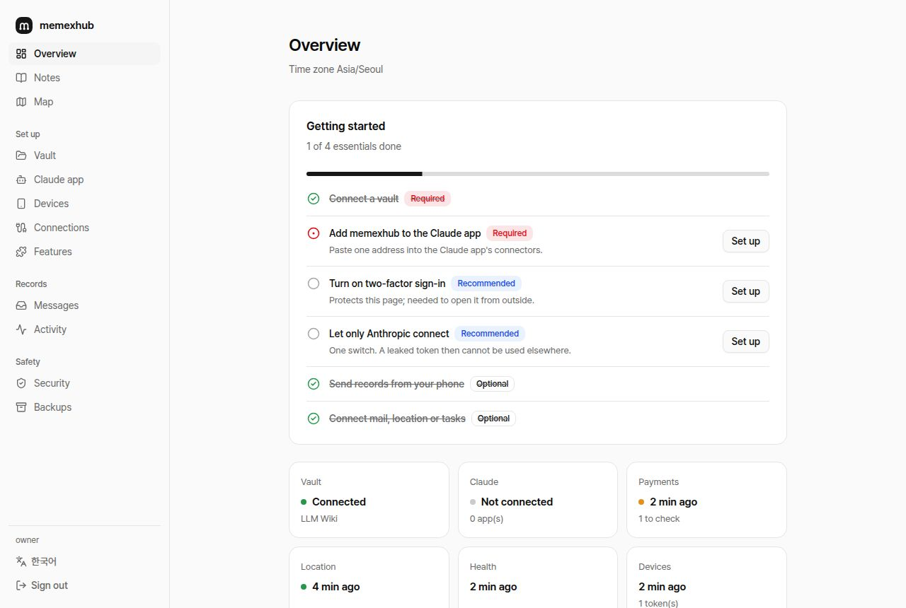
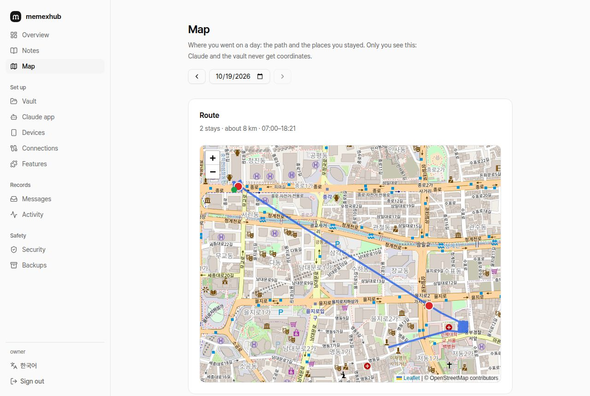
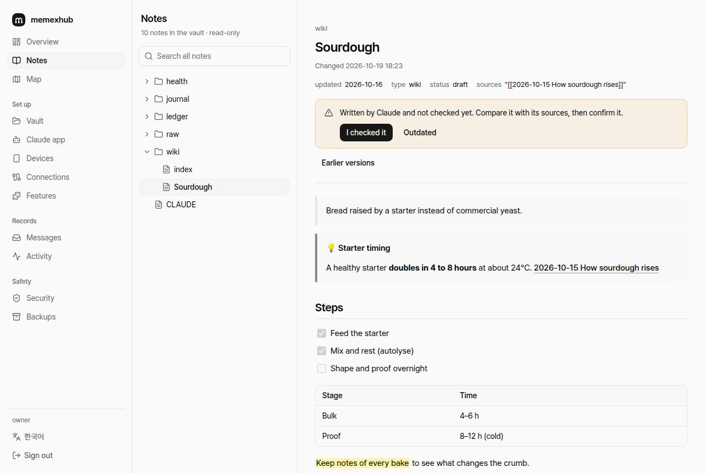
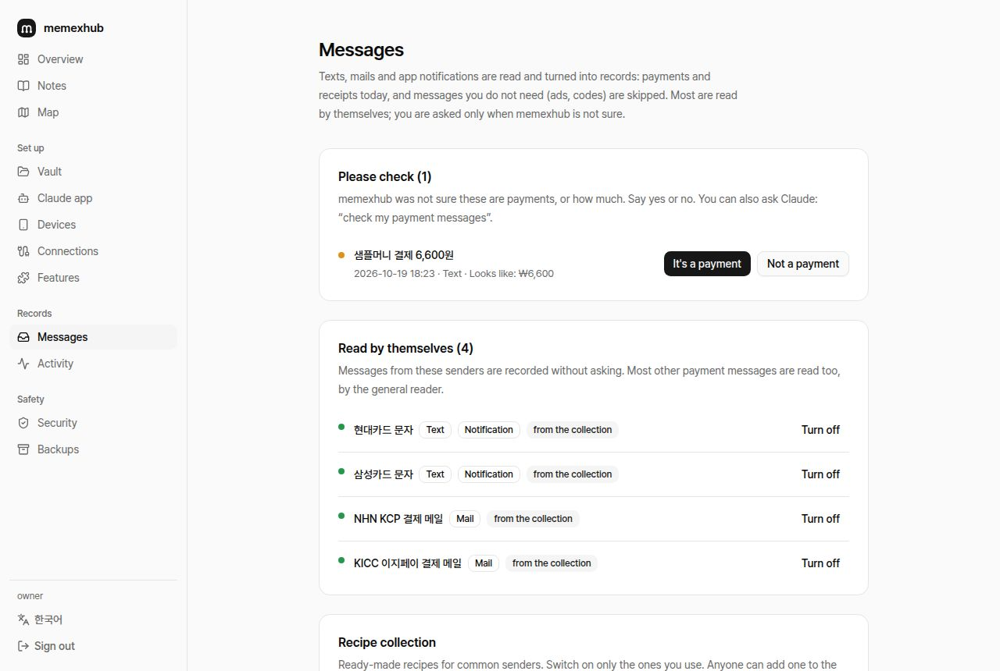

<p></p>

# memexhub

**A second brain for your AI.** A self-hosted server that gathers your notes and life logs in one place, keeps them tidy, and lets Claude (or any MCP client) use them through one connector.

[한국어](README.ko.md) · [Docs](docs/README.md) · [Security](SECURITY.md)

> ⚠️ Early (v0.1). A personal project, not affiliated with Anthropic or Obsidian.

## What you have 10 minutes after installing

- **Claude knows your notes.** Ask "find the meeting notes from last month" or "file this article in my wiki", and it searches, reads and writes your vault (a Markdown folder).
- **Your phone's records flow in by themselves.** Card payment texts, places you went, health, anything you "share" from any app. Phone setup is one QR scan. Calendars, mail and Home Assistant can join too (a calendar can be just its link).
- **A journal writes itself every night.** A Claude routine merges calendar, places and payments into "where, with whom, what, how much" and checks off the to-dos you really did. Copy the routine prompts from the admin page.

memexhub is not an agent and runs no model. Claude does the thinking; memexhub is the **memory** it reads from, on your server.

<table>
<tr><td></td><td></td></tr>
<tr><td align="center">Overview: getting started and status</td><td align="center">Map: the day's route and stays</td></tr>
<tr><td></td><td></td></tr>
<tr><td align="center">Notes: read the vault, Obsidian syntax</td><td align="center">Messages: payment texts and recipes</td></tr>
</table>

Every admin page: [page guide](docs/admin-ui.md)

## Install

**You need:** a server that runs Docker (NAS, home PC, VPS) and a public **HTTPS address**, because Claude connects from the internet. Any reverse proxy or tunnel works: Synology reverse proxy, Caddy, Cloudflare Tunnel.

```bash
mkdir memexhub && cd memexhub
curl -fsSLO https://raw.githubusercontent.com/Hchanghyeon/memexhub/main/compose.example.yml && mv compose.example.yml compose.yml
printf 'MEMEXHUB_SECRET=%s\nPUBLIC_URL=https://memex.example.com\nTZ=UTC\n' "$(openssl rand -base64 48)" > .env && chmod 600 .env
docker compose up -d && docker compose logs memexhub | grep -i "setup code"
```

1. Set `PUBLIC_URL` to your HTTPS address and route it to port 8787. Route 8790 too, for phone records. Details: [install guide](docs/install.md)
2. Open the admin page and enter the **setup code** from the log. For safety it listens only on the server (`127.0.0.1:8791`); from another computer use `ssh -L 8791:127.0.0.1:8791 your-server`, then `http://localhost:8791`.
3. Follow the 3-step setup: language and time → vault → connect the Claude app. The page tells you when Claude is connected.
4. Then set up your phone under **Devices**, and paste the prompts from the **Claude app** page into Claude app routines.

**No server?** [Cloudflare button](docs/cloudflare.md) · **Home Assistant, Synology, Railway:** [app stores](docs/app-stores.md) · **Development:** `npm install && npm run dev`

## How it stays tidy: an LLM Wiki

Your vault grows the **LLM Wiki** way Andrej Karpathy described:

- **Sources:** what you collected (articles, notes, logs). Saved once, never edited.
- **Wiki:** topic pages Claude writes from the sources. Every claim cites its source.
- **Rules:** a note telling Claude how this wiki works.

An AI can write its mistakes into your memory, so the work is split. **Claude judges**, **code checks** what has one right answer (links, citations, format), and **you confirm**: pages Claude writes stay drafts until you approve them. More: [wiki engine](docs/wiki-engine.md)

## Security

Built assuming it is on the internet, its code is public, and the AI can be fooled by what it reads.

- No tool sends data out (no mail sending, no arbitrary URL fetching)
- Claude connects with OAuth 2.1; the admin page is local-network only with two-factor; secrets are encrypted at rest
- Rule notes are protected from tools

Threat model: [security](docs/security.md). Report vulnerabilities privately: [SECURITY.md](SECURITY.md)

## More

- [Everything it does](docs/README.md#what-works): collect · organize · serve · admin pages
- [The admin pages](docs/admin-ui.md): what each page is for
- [Claude integration](docs/claude-integration.md) · [architecture](docs/architecture.md) · [contributing](CONTRIBUTING.md)

Named after *Memex*, the personal memory machine Vannevar Bush imagined in 1945.

## License

MIT
