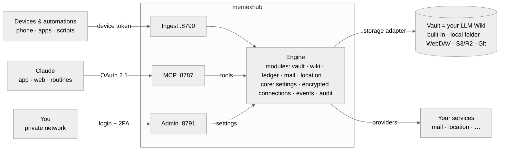

# memexhub

**A self-hosted memex — an LLM Wiki engine for Claude that keeps growing from your notes and life logs.**

[한국어](README.ko.md) · [Docs](docs/) · [Security](SECURITY.md)

> ⚠️ Early development (v0.1). Interfaces change. Not affiliated with Anthropic or Obsidian.

In 1945 Vannevar Bush imagined the *Memex*: a personal machine that stores everything you read and record, and links it together. memexhub is a small server that makes that real with today's tools:

- your **vault** — a folder of Markdown notes — is the memory. It can be an Obsidian vault, a folder on the server, WebDAV, S3/R2 or Git (Notion is planned),
- **Claude** (app, web, scheduled routines) reads and writes it through **one MCP connector**,
- the engine keeps the vault healthy as an **[LLM Wiki](#what-is-an-llm-wiki)** (sources stay untouched, the LLM maintains wiki pages, indexes and links are kept in order),
- and new **sources flow in by themselves** — articles you save, and life logs from your devices and services (card payments, transit, health, location, mail).



## What is an LLM Wiki?

A personal knowledge base that an LLM writes and maintains with you, instead of searching raw documents every time it is asked (the idea Andrej Karpathy described). It has three parts:

- **Sources** — what you collect: articles, notes, logs. Saved once, never edited.
- **Wiki** — pages the LLM writes from the sources and keeps up to date: topics, people, projects, summaries, linked to each other.
- **Rules** — one note that tells the LLM how this wiki is organised and how to write.

Knowledge is compiled into the wiki once and refined over time, so answers come from pages that already connect the dots. memexhub is the engine for it: it gives Claude the tools, protects the sources, keeps indexes, logs and links in order, and lints the wiki. The vault is just where the wiki is stored.

## Why

- **One connector, your data.** Claude gets a single, well-defined set of tools. Your data stays on your server or your own cloud account.
- **Your structure.** The engine knows *roles* (sources, wiki, index, daily notes, rules), not folder names. PARA, Zettelkasten, Karpathy's raw/wiki layout or a flat folder all work.
- **Deterministic where it matters.** Totals, tables, link checks and indexes are computed by the engine (exact, free). Judgement and writing are left to Claude.
- **Secure by default.** See [Security](#security).

## Status

| Area | Status |
|---|---|
| Core (settings, encrypted connections, event log, audit), runtime layer | ✅ |
| Vault storage: built-in / local folder, WebDAV, S3 / R2 / MinIO | ✅ · Git 📝 |
| Vault tools (list/read/search/stats/write/append/trash/move) with protected paths | ✅ |
| OAuth 2.1 for Claude connectors, device tokens, IP allowlist | ✅ |
| Admin UI: setup wizard, vault, connectors, device tokens, 2FA | ✅ minimal |
| Wiki module (layout, lint, save source, index, log, backlinks), roles & presets, write-once sources | ✅ |
| Ledger: card SMS (Hyundai, Samsung), Apple Pay / transit, payments & money notes, receipt mails, `payments_day`, message recipes + inbox | ✅ |
| Mail (read-only IMAP: Kakao, Naver, Gmail, Outlook, custom) — [docs](docs/mail.md) | ✅ |
| Location (Dawarich, OwnTracks, OSM place names), `location_day`, payment places | ✅ |
| Health (iOS Shortcuts, Health Auto Export), health note, `health_day` | ✅ |
| Tasks (Google Tasks, several accounts, sign-in button) | ✅ |
| `day_summary`, `week_summary` (one call per day / week for routines) | ✅ |
| Built-in WebDAV for Obsidian sync, Notion output, one-click Cloudflare deploy | 📝 |

## Quick start (development)

```bash
npm install
cp .env.example .env    # set MEMEXHUB_SECRET (openssl rand -base64 48) and PUBLIC_URL
npm run dev
```

The server prints a **one-time setup code**. Open the admin UI (`http://localhost:8791`), enter the code, create the admin account, connect a vault, then add `PUBLIC_URL/mcp` as a custom connector in Claude.

Docker images and one-click installs are planned — see [roadmap](docs/roadmap.md).

## Security

memexhub assumes it is on the internet, that its code is public, and that the LLM can be tricked by content it reads. Highlights:

- no tool ever sends data outward (no email sending, no arbitrary URL fetching),
- rule notes (e.g. `CLAUDE.md`) are protected — tools cannot rewrite the instructions your routines follow,
- OAuth 2.1 with PKCE, allow-listed redirect hosts, rotating refresh tokens with reuse detection, opaque hashed tokens,
- optional allowlist so `/mcp` only accepts Anthropic's servers,
- secrets encrypted at rest (AES-256-GCM), admin UI private by default, fresh instances locked behind a setup code.

Full threat model: [docs/security.md](docs/security.md). Report vulnerabilities privately: [SECURITY.md](SECURITY.md).

## Docs

[Architecture](docs/architecture.md) · [Wiki engine](docs/wiki-engine.md) · [Modules & providers](docs/modules-and-providers.md) · [Configuration & storage](docs/configuration-and-storage.md) · [Claude integration](docs/claude-integration.md) · [Ledger](docs/ledger.md) · [Message recipes](docs/recipes.md) · [Mail](docs/mail.md) · [Location](docs/location.md) · [Health](docs/health.md) · [Tasks](docs/tasks.md) · [Security](docs/security.md) · [Easy install](docs/easy-install.md) · [Roadmap](docs/roadmap.md) · [Adding a provider](docs/adding-a-provider.md) · [Development](docs/development.md) · [UI design](docs/design.md)

## License

MIT
