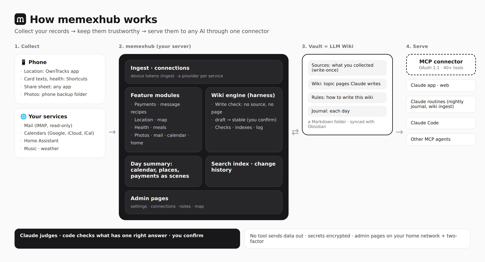
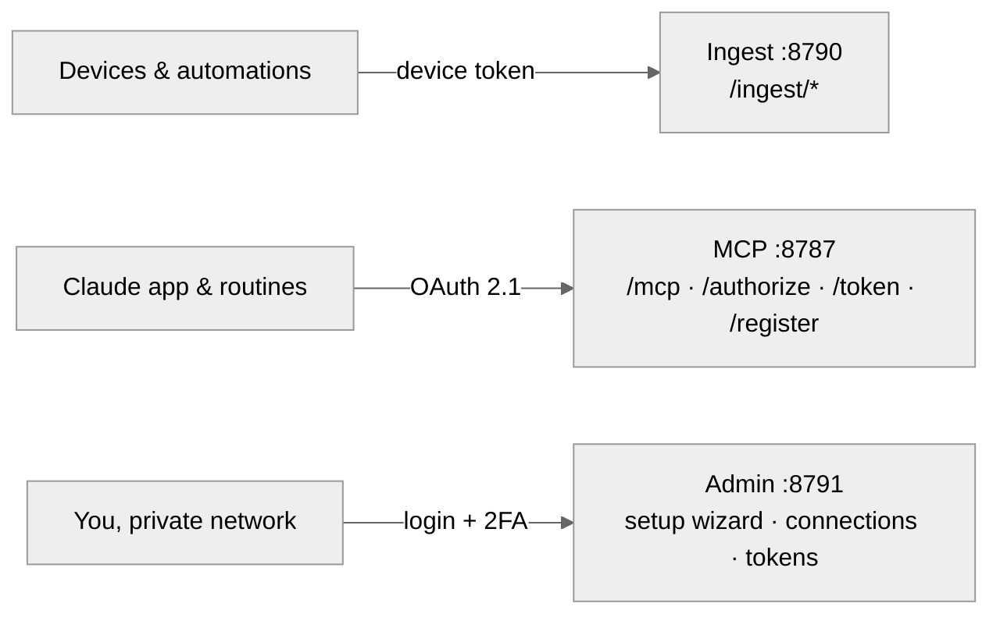
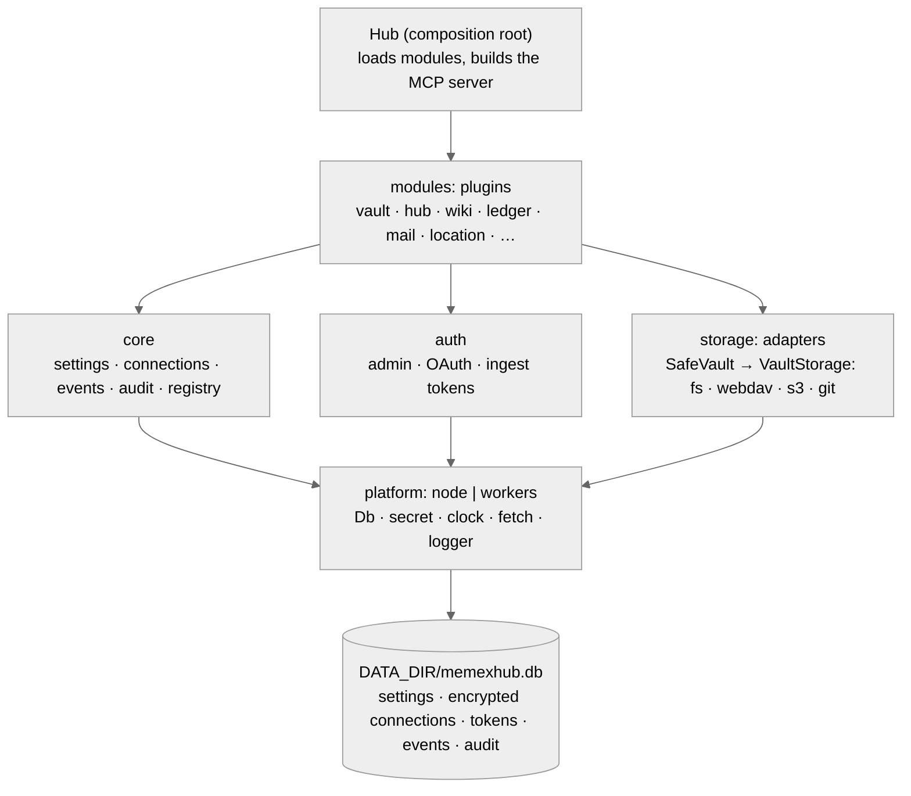

# Architecture

memexhub is one server with three entry points, a small core, pluggable modules and pluggable providers.

The picture is the big picture. The diagrams below show the same server by entry point and by layer.

## Principles

1. **LLM Wiki first.** The goal is a wiki Claude and you grow together. Life-log collection is one way sources arrive.
2. **Roles, not folders.** The engine never assumes a vault layout ([wiki engine](wiki-engine.md)).
3. **Engine computes, Claude judges.** Exact work (totals, tables, link checks, indexes) is done by the engine. Interpretation and prose are Claude's.
4. **Everything external is replaceable.** Storage, mail, location, geocoding, health, tasks, calendar: all behind interfaces.
5. **Secure by default, public code.** See [security](security.md).
6. **Small and portable.** Five runtime dependencies. Core code uses only web standards so it can run on Node and Cloudflare Workers.

## Entry points (listeners)

| Surface | Default port | Caller | Auth | Expose? |
|---|---|---|---|---|
| MCP | 8787 | Claude (Anthropic servers); your browser during connector login | OAuth 2.1 | yes, behind HTTPS; optionally Anthropic IPs only |
| Ingest | 8790 | any HTTP sender: phone automations (iOS Shortcuts, Android Tasker / MacroDroid), apps, scripts, home automation | device token with scopes | yes, behind HTTPS |
| Admin | 8791 | you | password + optional TOTP (off the home network), session cookie (30 idle minutes, or 30 days with "stay signed in"), CSRF | private networks only by default |

`LISTEN=single` serves everything on one port with path routing (simple setups, Workers).

## Request flows

**A card SMS arrives**: shortcut → `POST /ingest/message` (device token, scope `ledger`) → recipes / generic parser (unreadable → inbox for Claude) → dedupe → `EventBus.append` → renderer redraws the payments and money notes → `SafeVault.write` (skipped when unchanged).

**Claude summarizes a day**: nightly routine → `day_summary(date)` (one call returns stays, payments, transit, health, mail counts) → Claude decides and writes the daily note section with `write_note`.

**A new mail account**: admin UI → Connections → IMAP form → *Test* → saved with the password encrypted → the mail module picks it up on reload, no restart → Claude calls `mail_search(account="work")`.

## Design patterns in use

| Pattern | Where |
|---|---|
| Strategy / Adapter | `VaultStorage` adapters, providers, `Platform` (Node / Workers) |
| Decorator | `SafeVault` adds path policy, protected paths, size limits, trash, audit on top of any storage |
| Registry / Plugin | `src/modules/index.ts`, provider registry |
| Factory | storage/provider construction from connection rows |
| Chain of Responsibility | message extractors: vault recipes → built-in recipes → generic parser → inbox |
| Observer | `EventBus` → renderers redraw notes when facts arrive |
| Repository | settings, connections, tokens, events |
| Builder | a fresh stateless MCP server per request with only the visible tools |

## Code layout

See [CLAUDE.md](../CLAUDE.md#layout).
