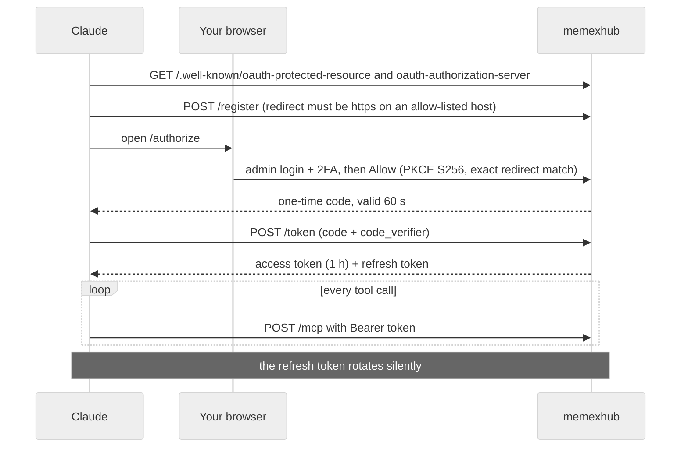

# Claude integration

## Connecting

1. Admin UI → copy `PUBLIC_URL/mcp`.
2. Claude app → Settings → Connectors → Add custom connector → paste.
3. Your browser opens memexhub's consent page → admin login (+ 2FA) → **Allow**.

Behind the scenes (OAuth 2.1):

- Tokens are **opaque random strings** stored as SHA-256 hashes: revoking a client in the admin UI takes effect immediately.
- Reusing an already-rotated refresh token revokes the whole token family (theft detection).
- With the IP allowlist on, `/mcp` only accepts Anthropic's outbound ranges, so a leaked token is useless elsewhere.
- You never copy a token. Nothing is stored on your phone.

## Engine computes, Claude judges

| Work | Who |
|---|---|
| payment/money notes, totals, tables, link checks, indexes, receipt-mail matching | engine (exact, no tokens) |
| choosing which stays become calendar events, one-line day summaries, weekly observations, wiki pages | Claude |

New tools that make routines cheap ✅:

- `day_summary(date)`: stays, payments, transit, health, mail counts in one compact call (no need to open large yearly notes). It starts with **scenes**: records of the same moment merged by time, e.g. `18:47–20:44 📍 stay · 💳 20:35 restaurant ₩… · 📅 18:00 dinner (from 📍💳📅)`. A payment joins the stay it falls in, a calendar event joins the scene that overlaps it most (appointments prefer places other than home or office), transit taps between places become moves, and a calendar event nothing matches is listed so a routine can leave it unchecked
- `week_summary(week)`: weekly numbers with week-over-week comparison, top merchants, recurring payments

Each module contributes its own part (a module added later shows up in the summaries by itself).
- `hub_status()` ✅: connection health and last received records (never settings or secrets)

## Routines

Scheduled Claude routines keep their instructions in vault notes (e.g. "read `rules/nightly.md` and follow the code block"). Put those notes under **protected paths** so a prompt-injected Claude cannot rewrite tomorrow's instructions.

## Tool language

Each tool has English and Korean descriptions. Admin UI → Claude connector → *Tool description language*: `en`, `ko` or `both`.

## Ready-made routines

The admin page **Claude app** has three routine prompts to copy into the Claude app's routines (scheduled tasks): **Daily journal** (nightly: scenes from `day_summary`, calendar events attached, to-dos checked only with evidence), **Wiki ingest** (nightly: `wiki_pending` → cited pages → `wiki_check` → re-read sources) and **Weekly check** (Sunday: `week_summary`, `wiki_lint`, drafts waiting; read only). Create the routine in a chat where the memexhub connector is on: the chat's connectors go with the routine. Paths come from `wiki_layout`, so the prompts work with any vault layout.
