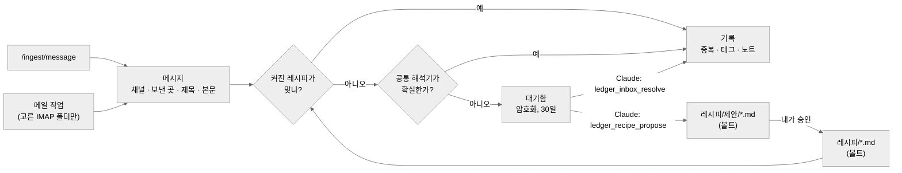

# 메시지 레시피

카드 문자, 결제 메일, 앱 알림 같은 **메시지**를 결제 기록으로 바꾸는 방법이에요. **카드사나 가게마다 코드를 짜지 않아요.** 📝 (P4)

## 왜

카드사, 은행, 가게마다 메시지 모양이 달라요. 보내는 곳마다 해석기 파일을 하나씩 만들면 끝이 없고, 사용자가 코드를 짜야 해요. 그래서 이렇게 나눠요.

- 대부분의 메시지는 **공통 해석기**가 읽어요. 금액, 시각, 가맹점, 승인·취소를 찾아요.
- 보내는 곳마다 다른 부분만 작은 **레시피**에 적어요. 레시피는 JSON 블록이고, **볼트에 노트로** 저장돼요.
- 엔진이 못 읽은 메시지는 **대기함**으로 가요. Claude가 판단해서 기록하고, **레시피를 제안**할 수 있어요. 그다음부터 같은 종류의 메시지는 엔진이 정확하게 읽어요.

"정답이 있는 건 엔진이, 판단은 Claude가" 원칙 그대로예요.

## 흐름



1. **메시지.** 들어오는 건 모두 `{ channel, from?, subject?, text, time?, lat?, lon? }` 모양이 돼요. 채널은 `sms`, `mail`, `notification`, `text` 중 하나예요. 원문은 `POST /ingest/message`로 들어와요. 이미 정리된 결제(Apple Pay)는 `/ingest/transaction`으로 와서 이 단계를 건너뛰어요.
2. **레시피.** 켜진 레시피를 차례로 시도해요. `match`가 맞는 첫 레시피가 값을 뽑아요. 빠진 값은 공통 해석기가 채워요(`generic: false`면 안 채움).
3. **공통 해석기.** P3에서 만든 한국 카드 문자 해석기예요. 금액 `12,500원`, 해외 금액 `USD 1.00`, `MM/DD HH:mm`, 승인·취소, 할부, 가맹점 줄을 찾아요. 결과는 **확실할 때만** 바로 기록해요. 금액, 시각, 승인·취소 단어, 카드 이름(`…카드`)을 모두 찾았을 때가 확실한 경우예요. 아니면 *추측*으로 남겨요.
4. **대기함.** 맞는 레시피가 없고 공통 해석기도 확실하지 않은 메시지가 추측과 함께 여기서 기다려요. Claude가 처리하거나, 관리 화면에서 내가 처리해요.
5. **기록.** 기록 방식은 그대로예요. 5분 안 같은 금액은 중복으로 보고, 취소, 교통·출입 태그, 온라인 가맹점, 늦게 온 메시지도 지금처럼 처리해요. **영수증**(`kind: "item"`)이 이미 있는 결제와 맞으면 그 결제에 품목 이름만 붙여요.

## 레시피는 어디에

레시피는 **볼트 노트**예요. 위키의 규칙이니까요. Obsidian에서 읽을 수 있고, 동기화되고, 볼트가 Git이면 이력도 남아요. Claude도 예시로 참고할 수 있어요.

| 폴더 | 해석에 쓰나 | 누가 쓰나 |
|---|---|---|
| `<레시피>/` | ✅ 켜짐 | 나 (Obsidian, 또는 관리 화면 **승인**). **Claude는 여기에 못 써요.** MCP 도구에는 보호 경로예요. |
| `<레시피>/proposed/` | ❌ 시험만 | Claude(`ledger_recipe_propose`), 나 |
| 기본 레시피 (저장소 `recipes/`) | ✅ | 기여자가 PR로 (JSON, 코드 아님) |

`<레시피>`는 볼트 역할이에요([위키 엔진](wiki-engine.md)). 기본값은 `memexhub/recipes`이고 프리셋마다 정해져 있어요. 기본 레시피와 같은 `id`의 볼트 노트가 있으면 노트가 우선이에요. 노트에 `enabled: false`를 쓰면 기본 레시피가 꺼져요.

볼트 연결이 없으면 기본 레시피만 써요.

### 레시피 노트 예시

````markdown
---
type: recipe
---
# 신한카드 문자

신한카드 승인·취소 문자. 카드 이름은 상품명.

```json memexhub-recipe
{
  "id": "kr.shinhan.sms",
  "channels": ["sms"],
  "match": { "any": ["신한카드"] },
  "extract": ["^신한카드\\((?<last4>\\d{4})\\)"],
  "set": { "card": "신한카드" }
}
```

## 예시

```text
신한카드(1234)승인 홍*동 12,500원(일시불)10/14 12:30 샘플카페 누적345,000원
```
```json memexhub-expect
{ "merchant": "샘플카페", "amount": "₩12,500", "card": "신한카드 일시불" }
```
````

엔진은 `memexhub-recipe` 블록만 읽어요. `text`와 `memexhub-expect` 쌍은 **시험**이에요. 예시가 틀리는 레시피는 쓰지 않고, 관리 화면에 이유를 보여줘요. 예시는 가짜로 써요 (이름, 가맹점, 금액, 누적액을 바꿔서).

## 레시피 형식

| 키 | 형식 | 뜻 |
|---|---|---|
| `id` | `[a-z0-9._-]{3,64}` | 고유값. 관례는 `<나라>.<보낸 곳>.<채널>` |
| `name` | 문자열 | 관리 화면 표시 이름 (없으면 노트 제목) |
| `channels` | `sms` · `mail` · `notification` · `text` | 볼 메시지 종류 |
| `match.from` / `match.subject` | 정규식 | 보낸 곳, 메일 제목 |
| `match.any` / `all` / `none` | 정규식[] | 본문 조건 |
| `kind` | `payment`(기본) · `item` · `ignore` | `item`은 있는 결제에 품목 이름을 붙여요(영수증). `ignore`는 맞는 메시지를 조용히 버려요(광고, 인증번호). |
| `extract` | 정규식[] | 이름 붙은 그룹이 값을 채워요: `amount` `currency` `merchant` `card` `item` `plan` `year` `month` `day` `hour` `minute`. 값마다 처음 찾은 게 이겨요. |
| `cancel` | 정규식 | 취소 표시 (기본 `취소`) |
| `set` | 객체 | 고정값. `{그룹}`은 뽑은 값을 넣어요. 예: `"card": "현대카드 {product}"` (없는 그룹과 남는 빈칸은 지워요) |
| `generic` | 참/거짓 | 빠진 값을 공통 해석기로 채움 (기본 `true`) |
| `enabled` | 참/거짓 | 기본 `true` |

값이 아닌 그룹(위의 `last4` 같은 것)은 `set`에서만 쓸 수 있고 **저장하지 않아요.** 카드 번호는 절대 기록하지 않아요.

### 제한 (정규식 안전)

JavaScript 정규식은 중간에 멈출 수 없어서, 쓰기 전에 검사해요.

- 패턴 하나 300자 이하, 레시피 하나에 패턴 20개 이하, 켜진 레시피 200개 이하
- 역참조 금지, 20자보다 긴 lookbehind 금지, `(a+)+`나 `(\w*)*` 같은 중첩 반복 금지
- 메시지는 맞춰 보기 전에 자름: 문자 4KB, 메일 본문 16KB
- 레시피는 값을 뽑기만 해요. 코드를 실행하거나, 주소를 부르거나, 노트를 쓰지 못해요.

## 대기함

- **결제처럼 보이는** 메시지만 들어가요(금액은 찾은 경우). 나머지는 거절하고 아무것도 남기지 않아요.
- DB에 **암호화**해서 저장해요(AES-256-GCM, 전용 키 용도). 이유와 공통 해석기의 추측도 같이 저장해요. 원문에는 이름 일부와 카드 끝자리가 있고 볼트는 폰으로 동기화되니까, 볼트에는 **넣지 않아요.**
- 들어온 지 30일이 지나거나 처리하면 지워요 (설정 가능).
- Claude에게 보여줄 때는 8자리 이상 숫자(계좌·카드 번호)를 가려요.

## Claude 도구

| 도구 | 하는 일 | 쓰는 곳 |
|---|---|---|
| `ledger_inbox` ✅ | 대기 중인 메시지와 이유, 추측. 본문은 **신뢰할 수 없는 내용**으로 표시해요. | — |
| `ledger_inbox_resolve(id, record \| ignore, fields?)` ✅ | 기록(값을 고쳐서도 가능)하거나 버려요 | 결제 기록 |
| `ledger_recipe_propose(recipe_json, description?, samples?)` ✅ | 레시피를 검사하고, 실제 대기함 문자를 베낀 예시는 거절하고, 대기함 예시와 자체 예시로 시험한 뒤 `<레시피>/proposed/`에 써요. 예시별 결과를 돌려줘요. | 볼트, 제안 폴더만 |
| `ledger_recipes` ✅ | 켜진·제안된·고장 난 레시피(이유 포함), 대기함 개수 | — |

보통 이렇게 써요: *"결제 대기함 보고 정리해 줘."* Claude는 켜진 레시피 노트를 예시로 읽고, 분명한 건 기록하고, 새로 보는 곳이면 레시피를 제안해요. 그다음 같은 곳에서 온 메시지는 Claude 없이 엔진이 읽어요.

## 관리 화면

**기능 → 결제 → 레시피·대기함** ✅에서 할 수 있어요.

- **메시지 시험.** 문자를 붙여 넣으면 어느 단계(레시피, 공통 해석기, 대기함)가 처리했는지와 뽑은 값을 보여줘요.
- **레시피 목록.** 기본, 켜진, 제안된 레시피를 시험 결과와 함께 보여줘요. **승인**을 누르면 제안 노트를 `<레시피>/`로 옮기고, **끄기**를 누르면 `enabled: false`가 돼요.
- **메시지로 새 레시피.** 공통 해석기의 추측으로 초안을 만들어요. 고친 뒤 노트로 저장해요.
- **대기함.** 항목마다 기록, 고쳐서 기록, 버리기를 할 수 있어요.
- **가져오기 / 내보내기.** 다른 사람이 공유한 레시피 묶음(JSON)을 받아요. 레시피마다 제안 노트로 들어가요.

## 메일 ✅

메일 작업은 15분마다 돌고, **결제 → 메일 출처**에 적은 폴더만 읽어요. 한 줄에 `계정: 폴더`, 예: `kakao: 결제`. 폴더마다 UID 위치를 기억하고, 새 메일을 `channel: "mail"`, `from`, `subject`가 붙은 메시지로 넘겨요. KCP나 온라인 쇼핑몰 같은 결제 메일은 `kind: "item"` 또는 `"payment"` 레시피예요. 레시피가 알아본 메일만 기록하고, 결제처럼 보이는 다른 메일은 대기함으로 보내요(메일에는 공통 해석기를 믿지 않아요). 도구 `payments_from_mail(since?, until?)`는 같은 작업을 바로 실행해요. 기본 레시피: `kr.kcp.mail`(NHN KCP 결제·취소 메일).

## 기본 레시피

저장소의 `recipes/*.json`에 파일 하나당 레시피 하나가 가짜 `examples`와 함께 들어 있어요. 새 카드사나 가게를 기여하려면 코드가 아니라 **JSON 파일 하나**를 추가하면 돼요. CI가 기본 레시피를 모두 예시로 시험해요.
