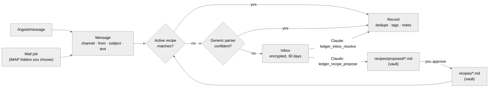

# Message recipes

How memexhub turns **messages** — card SMS, receipt mails, app notifications — into ledger records **without code per card company or shop**. 📝 (P4)

## Why

Every card company, bank and shop writes its messages differently. One parser file per sender does not scale and makes users write code. Instead:

- most messages are understood by a **generic parser** (amount, time, merchant, approval / cancellation),
- what differs per sender is a small **recipe**, a JSON block stored **as a note in your vault**,
- anything the engine cannot read goes to an **inbox**, where Claude decides and can **propose a recipe**, so the next message of that kind is parsed exactly.

This follows the rule "the engine computes, Claude judges".

## Flow



1. **Message.** Every input becomes `{ channel, from?, subject?, text, time?, lat?, lon? }`. The channel is one of `sms`, `mail`, `notification` or `text`. Raw text arrives at `POST /ingest/message`. Already structured payments (Apple Pay) use `/ingest/transaction` and skip this step.
2. **Recipes.** Active recipes are tried in order. The first one whose `match` fits extracts the fields. Missing fields are filled by the generic parser unless `generic: false`.
3. **Generic parser.** This is the Korean card-SMS parser shipped with P3: amount `12,500원`, foreign amounts `USD 1.00`, `MM/DD HH:mm`, approval / cancellation, instalments, and the merchant line. Its result is recorded directly only when it is **confident**: an amount, a time, an approval or cancellation word, and a card name (`…카드`) were all found. Otherwise the result is kept as a *guess*.
4. **Inbox.** Messages that no recipe matched and the generic parser was not sure about wait here, together with the guess. Claude resolves them, or you do in the admin UI.
5. **Record.** Recording is unchanged: dedupe (same amount within 5 minutes), cancellations, transit and office tags, online merchants, late messages. A **receipt** (`kind: "item"`) that matches an existing payment only adds its item name to that payment.

## Where recipes live

Recipes are **vault notes**, because they are rules of your wiki: readable in Obsidian, synced, versioned if your vault is in Git, and Claude can read them as examples.

| Folder | Used for parsing | Who writes |
|---|---|---|
| `<recipes>/` | ✅ active | you (Obsidian, or **Approve** in the admin UI). **Claude cannot write here**: the folder is a protected path for MCP tools. |
| `<recipes>/proposed/` | ❌ only tested | Claude (`ledger_recipe_propose`), you |
| built-in (`recipes/` in the repository) | ✅ | contributors, by pull request (JSON, no code) |

`<recipes>` is a vault role (see [wiki engine](wiki-engine.md)). The default is `memexhub/recipes`, and presets set their own. A vault note with the same `id` as a built-in recipe overrides it. Setting `enabled: false` in a note switches a built-in recipe off.

Without a vault connection only the built-in recipes are used.

### A recipe note

````markdown
---
type: recipe
---
# Shinhan Card SMS

Approval and cancellation texts from Shinhan Card. The card label is the product name.

```json memexhub-recipe
{
  "id": "kr.shinhan.sms",
  "channels": ["sms"],
  "match": { "any": ["신한카드"] },
  "extract": ["^신한카드\\((?<last4>\\d{4})\\)"],
  "set": { "card": "신한카드" }
}
```

## Examples

```text
신한카드(1234)승인 홍*동 12,500원(일시불)10/14 12:30 샘플카페 누적345,000원
```
```json memexhub-expect
{ "merchant": "샘플카페", "amount": "₩12,500", "card": "신한카드 일시불" }
```
````

The engine reads only the `memexhub-recipe` block. The `text` and `memexhub-expect` pairs are **tests**: a recipe whose examples fail is not used, and the admin UI shows why. Examples must be fake (rewrite names, merchants, amounts and balances).

## Recipe format

| Key | Type | Meaning |
|---|---|---|
| `id` | `[a-z0-9._-]{3,64}` | unique; convention `<country>.<sender>.<channel>` |
| `name` | string | shown in the admin UI (defaults to the note title) |
| `channels` | `sms` · `mail` · `notification` · `text` | which messages this recipe looks at |
| `match.from` / `match.subject` | regex | sender, or mail subject |
| `match.any` / `all` / `none` | regex[] | conditions on the text |
| `kind` | `payment` (default) · `item` · `ignore` | `item` adds an item name to an existing payment (receipts); `ignore` silently drops matching messages (ads, OTPs) |
| `extract` | regex[] | named groups fill fields: `amount` `currency` `merchant` `card` `item` `plan` `year` `month` `day` `hour` `minute`. The first match per field wins. |
| `cancel` | regex | marks a cancellation (default `취소`) |
| `set` | object | constant fields; `{group}` inserts a captured group, e.g. `"card": "현대카드 {product}"` (missing groups and extra spaces are dropped) |
| `generic` | boolean | fill missing fields with the generic parser (default `true`) |
| `enabled` | boolean | default `true` |

Groups that are not fields (like `last4` above) can be used in `set` but are **never stored**. Card numbers are never recorded.

### Limits (regex safety)

JavaScript regexes cannot be interrupted, so recipes are checked before use:

- each pattern ≤ 300 characters, ≤ 20 patterns per recipe, ≤ 200 active recipes;
- no backreferences, no lookbehind longer than 20 characters, no nested quantifiers such as `(a+)+` or `(\w*)*`;
- messages are cut to 4 KB (SMS) or 16 KB of text (mail) before matching;
- recipes only extract values. They cannot run code, call URLs or write notes.

## Inbox

- Only **payment-like** messages go here: at least an amount was found. Anything else is rejected and nothing is kept.
- Stored in the database, **encrypted** (AES-256-GCM, its own key purpose), with the reason and the generic guess. It is **not** stored in the vault, because raw messages carry partial names and card digits and the vault syncs to phones.
- Items are deleted 30 days after arrival, or when resolved (configurable).
- Digit runs of 8 or more (account or card numbers) are masked whenever an item is shown to Claude.

## Claude tools

| Tool | Does | Writes |
|---|---|---|
| `ledger_inbox` ✅ | pending messages with reason and guess. Text is marked **untrusted**. | — |
| `ledger_inbox_resolve(id, record \| ignore, fields?)` ✅ | records the message (optionally with corrected fields) or drops it | ledger event |
| `ledger_recipe_propose(recipe_json, description?, samples?)` ✅ | validates a recipe, refuses examples copied from real inbox messages, tests it against its own examples and the inbox samples, writes it to `<recipes>/proposed/`, returns per-sample results | vault, proposed folder only |
| `ledger_recipes` ✅ | active, proposed and broken recipes (with the reason), and the inbox count | — |

Typical use: *"Look at the ledger inbox and handle it."* Claude reads the active recipe notes as examples, records what is clear, and proposes a recipe for a new sender. The next message from that sender is then parsed by the engine without Claude.

## Admin UI

Under **Features → Ledger → Recipes & inbox** ✅:

- **Try a message.** Paste a text and see which step handled it (recipe, generic parser or inbox) and the fields.
- **Recipes.** Lists built-in, active and proposed recipes, with test results. **Approve** moves a proposed note into `<recipes>/`, and **Disable** sets `enabled: false`.
- **New recipe from a message.** Builds a draft from the generic guess. You adjust it and save it as a note.
- **Inbox.** Record, edit and record, or ignore each item.
- **Import / export.** Accepts a JSON pack of recipes (e.g. shared by others); each recipe is written as a proposed note.

## Mail

The mail job (every 15 minutes) reads only the folders listed in **Ledger → Mail sources**, e.g. `connection: kakao, folder: 결제`. It keeps a per-folder UID cursor and feeds each new mail as a message with `channel: "mail"`, `from` and `subject`. Receipt mails such as KCP or online shops are recipes with `kind: "item"` or `"payment"`. The tool `payments_from_mail(date?)` runs the same job on demand.

## Built-in recipes

`recipes/*.json` in the repository holds one recipe per file, with fake `examples`. Contributing a new card company or shop means adding **one JSON file**, not code. CI tests every built-in recipe against its examples.
